## 구현 내용

- useMutation으로 회원가입·로그인·회원 정보 수정 요청 관리
- Zustand persist로 토큰 저장 및 로그인 전용 Route Group·Layout Route 구성
- 즐겨찾기 목록·상태 조회·등록·삭제와 평점 조회·등록·수정·삭제 연결
- 백엔드 즐겨찾기 CRUD 및 영화 기록 트랜잭션 저장 구현
- 실제 화면 검증 중 발견한 평점 PATCH 요청의 불필요한 movieId 전송 수정
- 프론트 빌드·타입 검사, 백엔드 통합 테스트 및 헤드리스 브라우저 흐름 검증

 

## 실행 화면

로컬 Spring Boot 서버와 H2 캡처용 DB를 연결한 실제 실행 결과입니다. 영화 정보는 로컬 샘플 데이터입니다. API 이미지는 실제 응답을 브라우저 보고서로 렌더링한 캡처입니다.

### 로그인

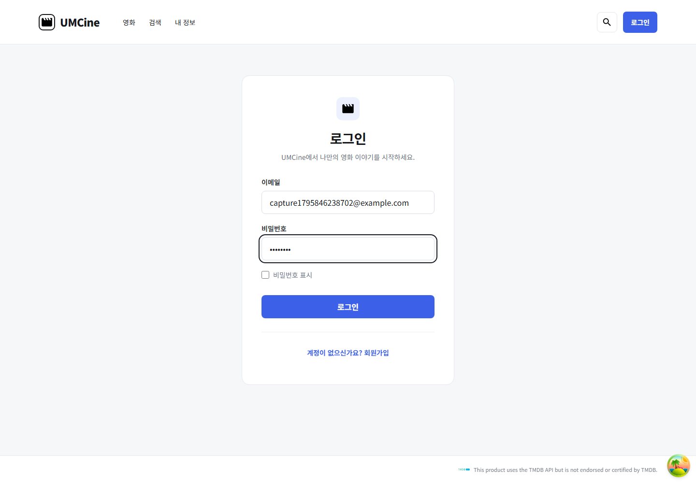

### 즐겨찾기·평점 등록

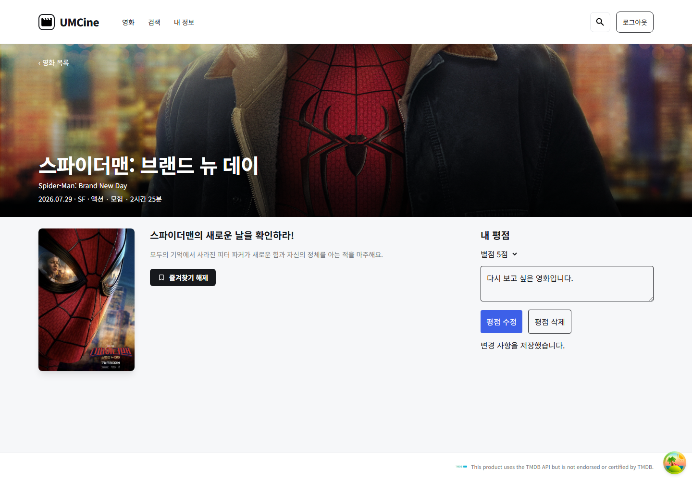

### 평점 수정 후 새로고침

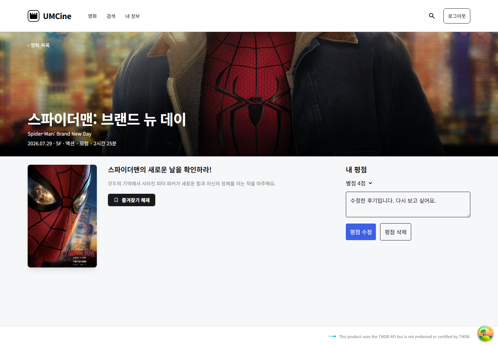

### 마이페이지 즐겨찾기

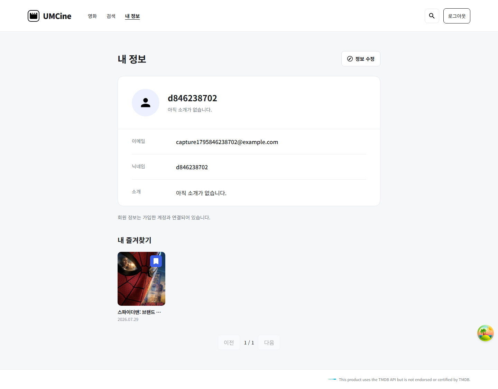

### 회원 정보 수정

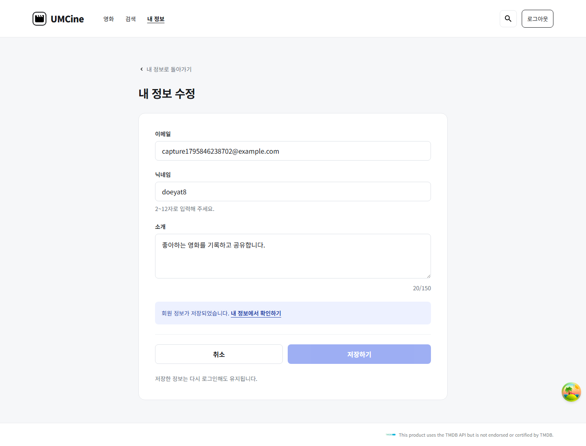

### 평점 삭제

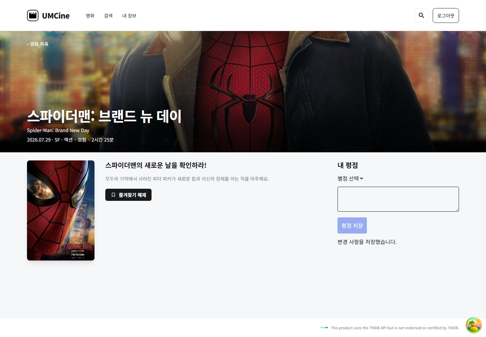

백엔드 API 응답 6개 보기

### 즐겨찾기 등록

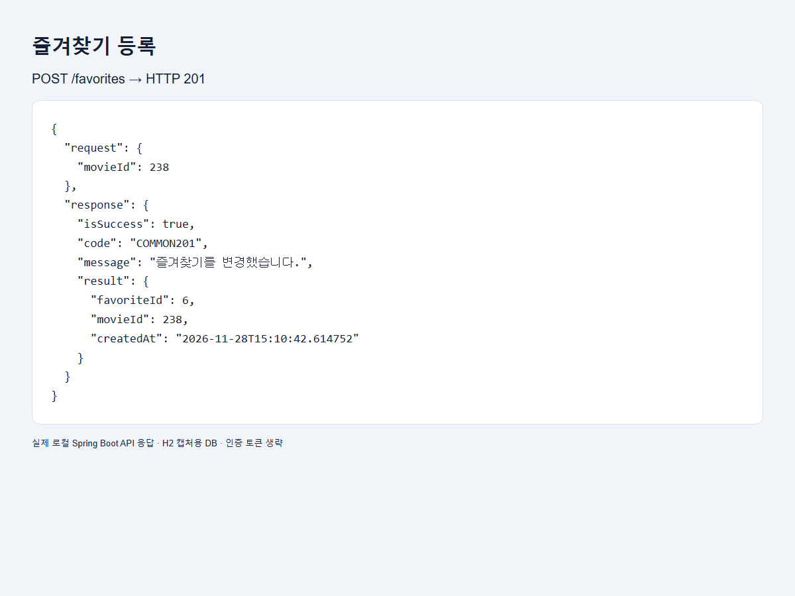

### 중복 등록 거절

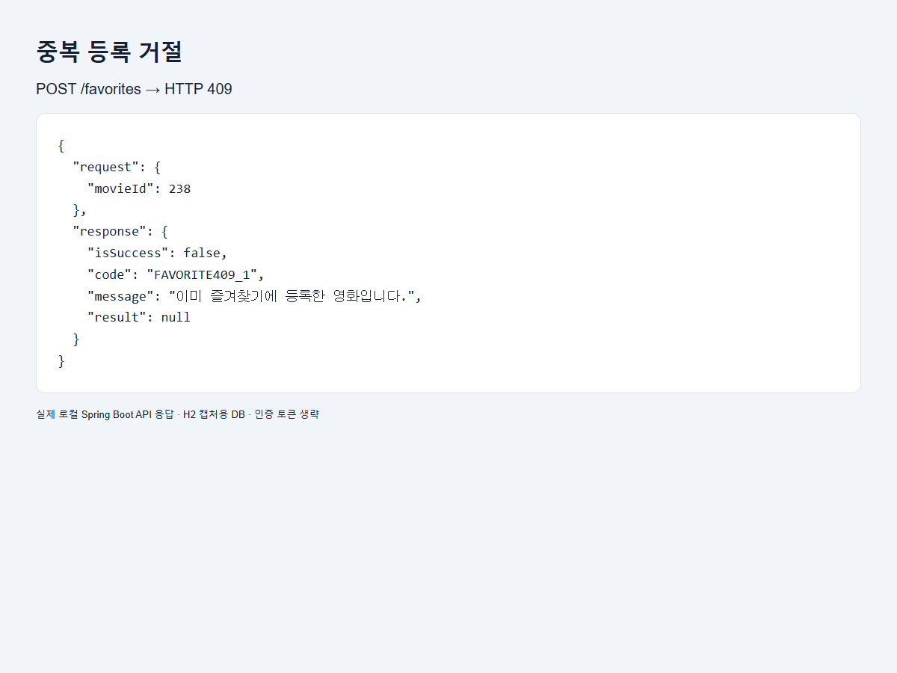

### 내 즐겨찾기 목록

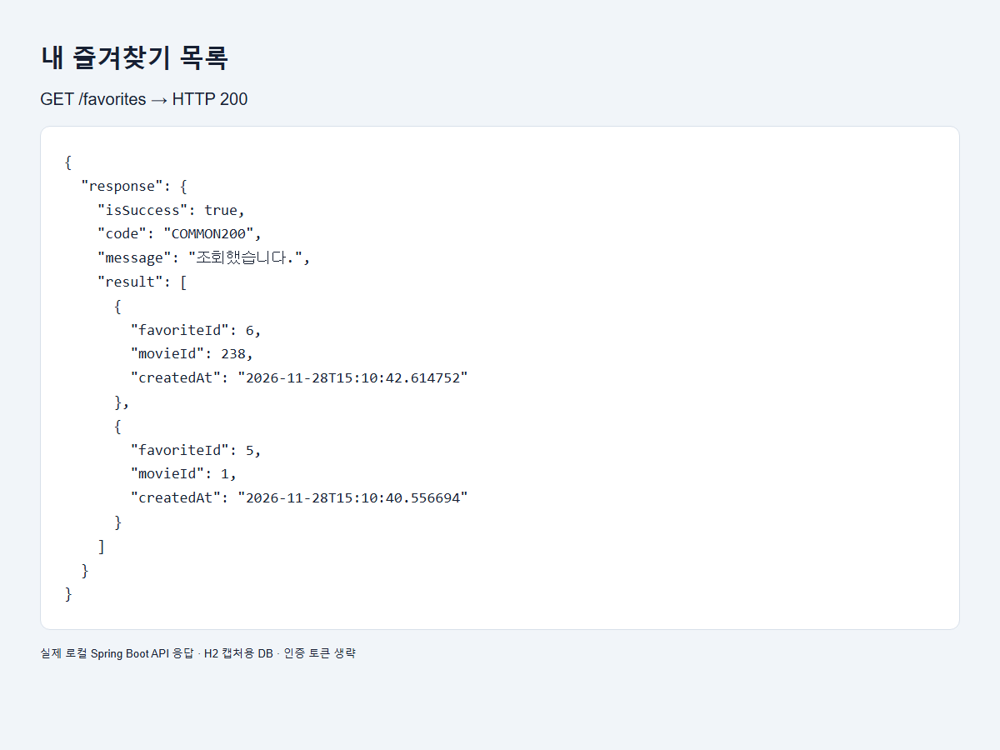

### 즐겨찾기 여부

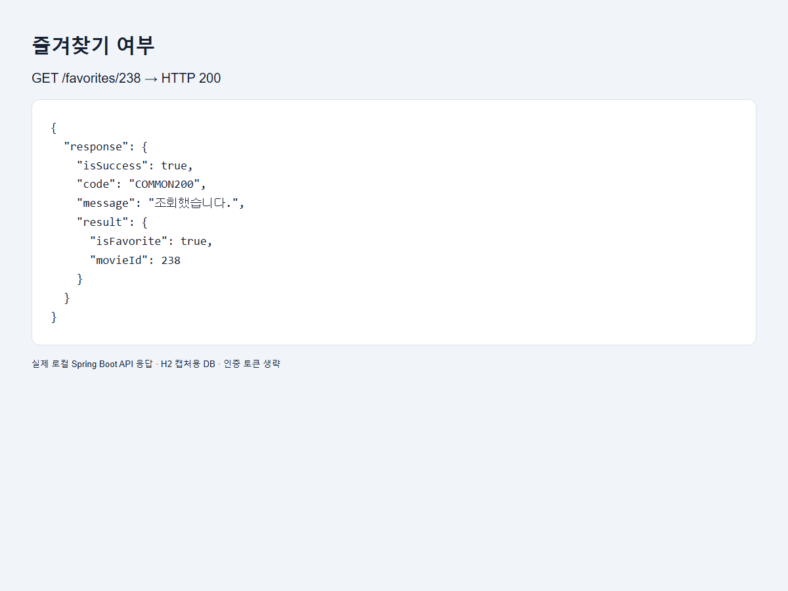

### 즐겨찾기 삭제

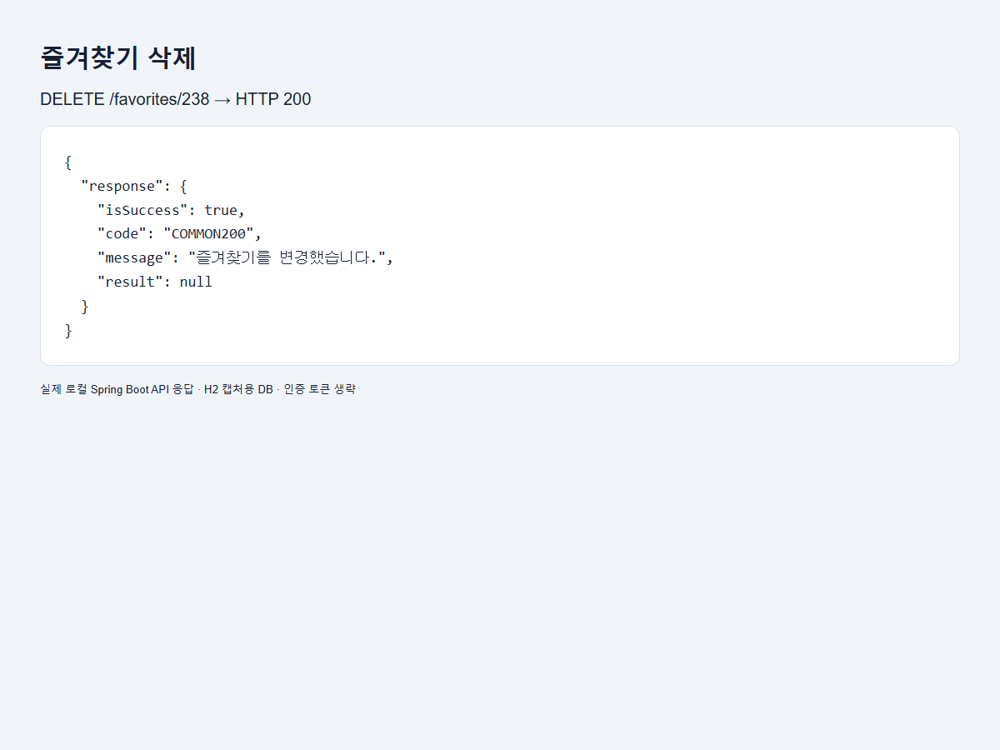

### 영화 기록 동시 저장

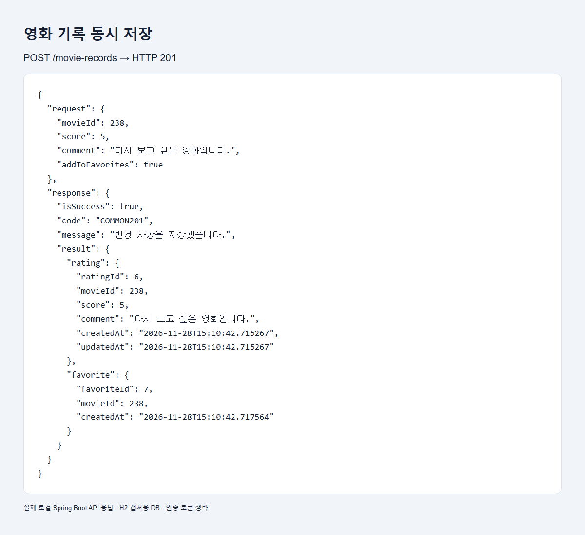

 

## 느낀 점

서버 데이터는 Query 캐시에서 관리하고, 로그인 토큰은 Zustand에서 관리하는 구조를 적용했습니다. invalidateQueries로 목록을 다시 조회하는 방식과 setQueryData로 수정 응답을 즉시 반영하는 방식의 차이를 확인했습니다.

실제 브라우저 검증에서 평점 수정 요청이 서버 DTO에 없는 필드 때문에 거절되는 문제를 발견했습니다. 빌드와 타입 검사 외에도 실제 요청·응답과 새로고침 후 데이터 유지까지 확인하는 과정이 필요하다는 점을 배웠습니다.
