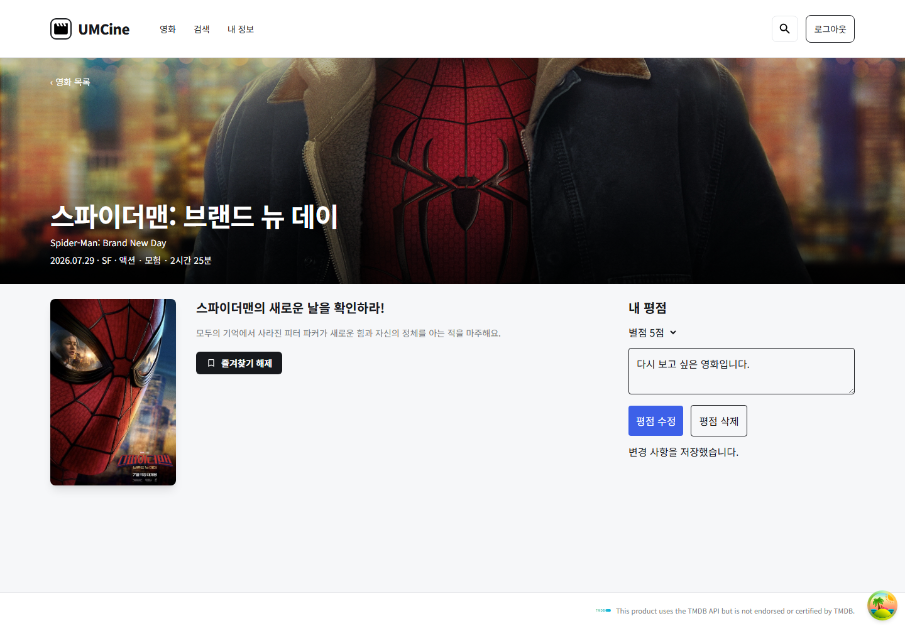
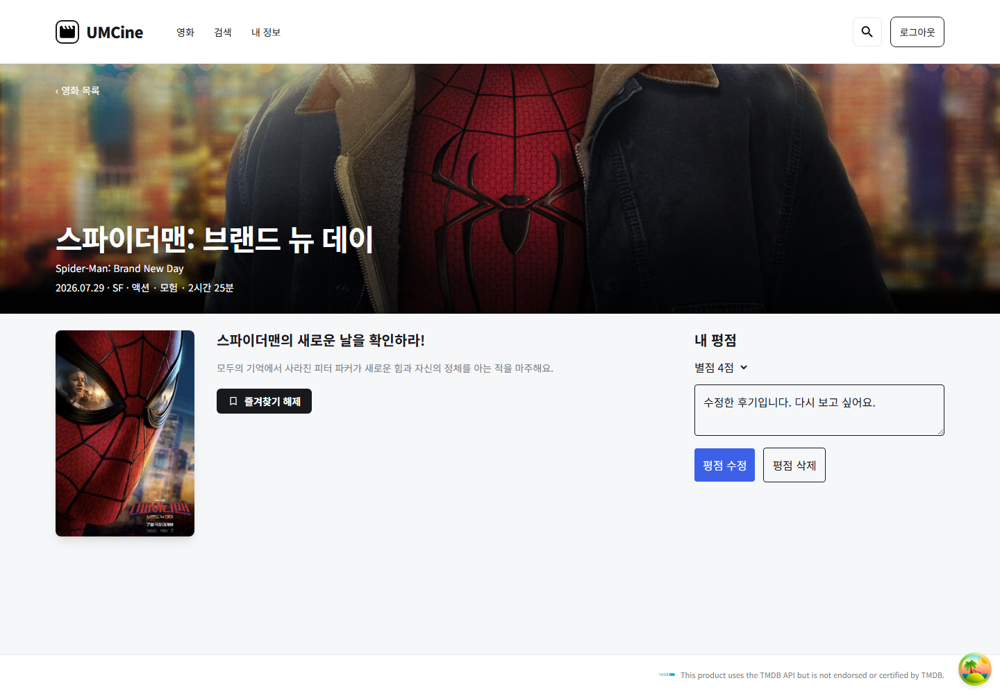
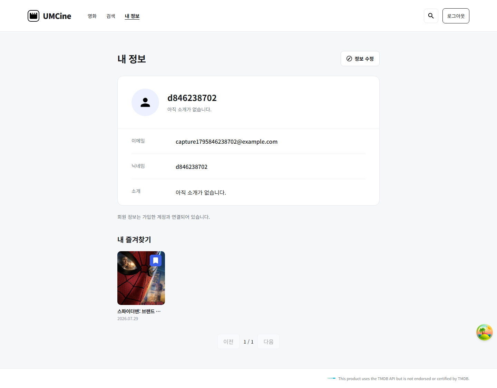
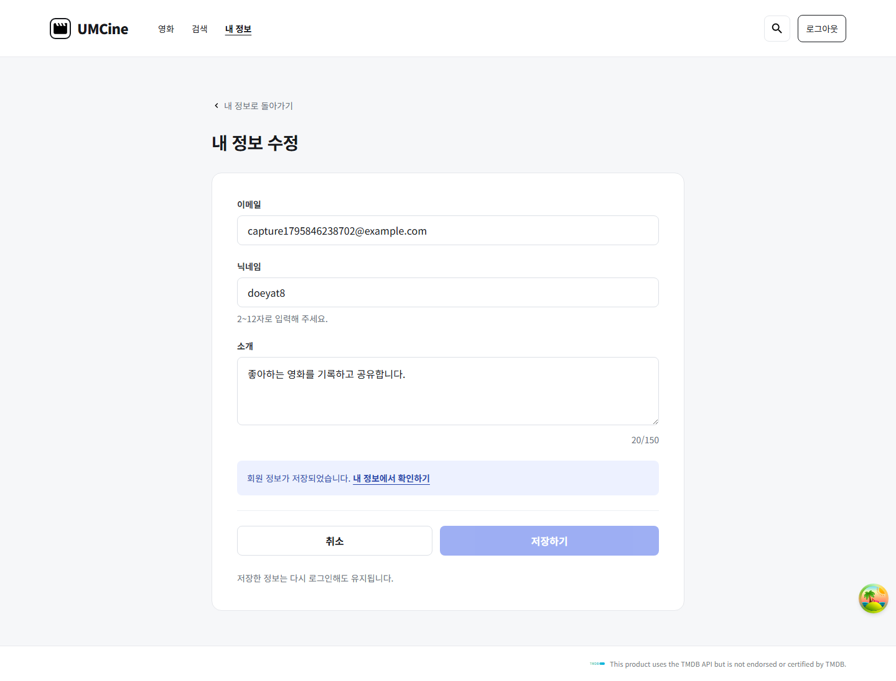

# 8주차 프론트 미션 기록

- 회원가입·로그인·회원 수정은 hooks/use-account.ts의 useMutation으로 요청 상태를 관리한다.
- 인증 토큰은 Zustand persist로 localStorage에 저장하고 인증 응답 401에서 제거한다.
- 회원 정보는 useMe의 Query 캐시만 사용한다. 로그인 성공 시 invalidateQueries로 재조회하고 회원 수정 성공 시 setQueryData로 응답을 바로 반영한다.
- routes/(authenticated)/_auth.tsx에서 beforeLoad와 Outlet으로 로그인 전용 페이지를 묶었다.
- 즐겨찾기 목록은 서버에서 조회한다. 상세에서 GET /favorites/{movieId}로 변경 전 상태를 확인하고 등록·삭제한다.
- 상세의 평점은 로그인한 회원 목록에서 찾아 등록·수정·삭제한다. 성공 후 평점 목록을 재조회한다.

invalidateQueries는 서버에 추가 요청해 최신 목록을 받는다. setQueryData는 성공 응답으로 캐시를 바로 갱신해 추가 조회 없이 헤더·마이페이지에 수정 결과를 반영한다.

직접 확인할 흐름: 회원가입 → 로그인 → 새로고침 → 즐겨찾기 등록/해제 → 마이페이지 → 평점 등록/수정/삭제 → 정보 수정 → 로그아웃 후 접근 제한.

헤드리스 Chromium으로 실제 프론트와 로컬 Spring Boot 서버를 연결해 캡처했다. 로그인, 즐겨찾기 등록·목록, 평점 등록·수정·새로고침 유지·삭제, 회원 수정, 로그아웃 후 접근 제한을 검증했다. 캡처 중 발견한 평점 PATCH의 불필요한 movieId 전송을 제거했다.

검증: Vite 빌드와 TypeScript 검사 통과. npm ci 다운로드가 멈춰 중단했고, 로컬 6주차의 설치된 의존성을 연결해 검증했다(Vite 8.3.0). 8주차 package-lock의 정확한 버전 조합으로 설치·검증은 아직 완료하지 못했다.
