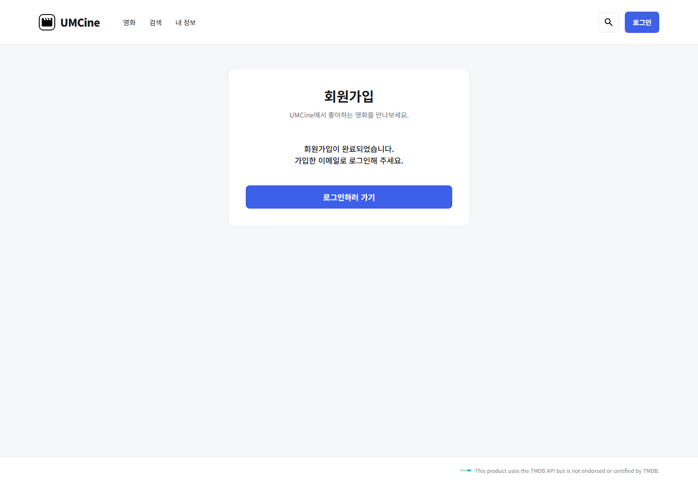
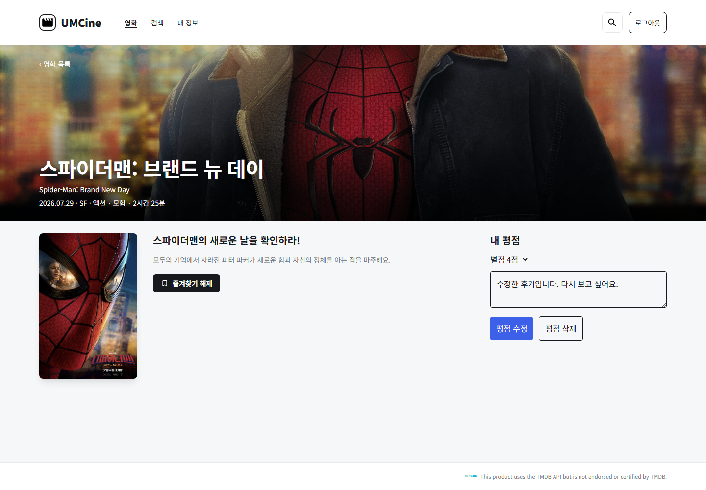
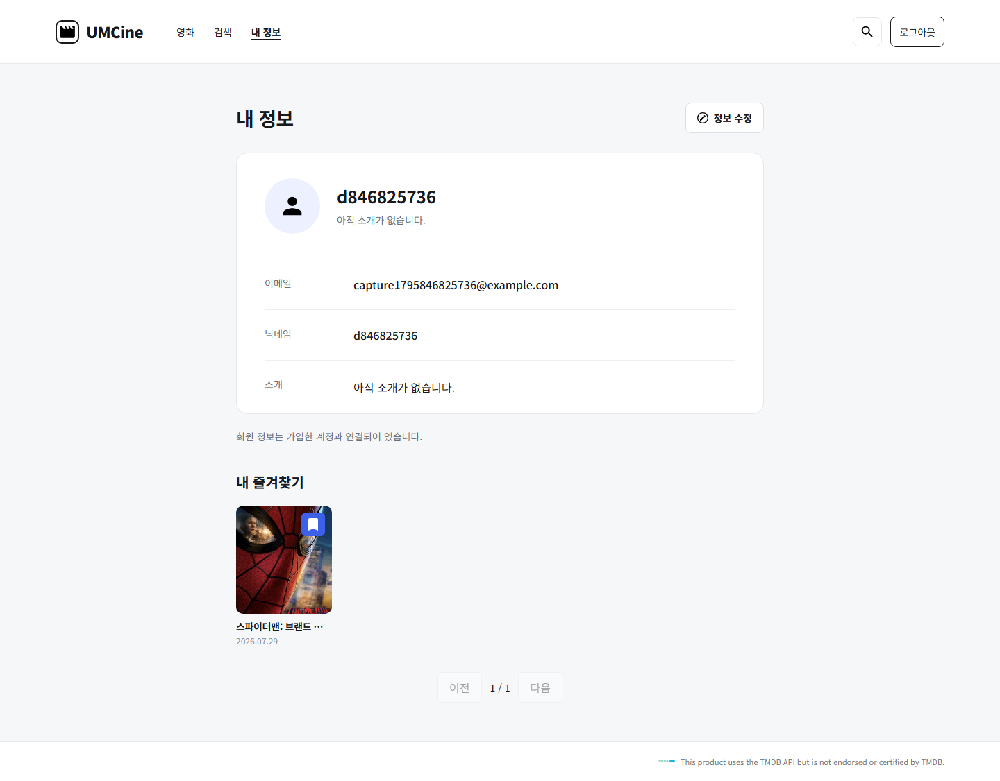
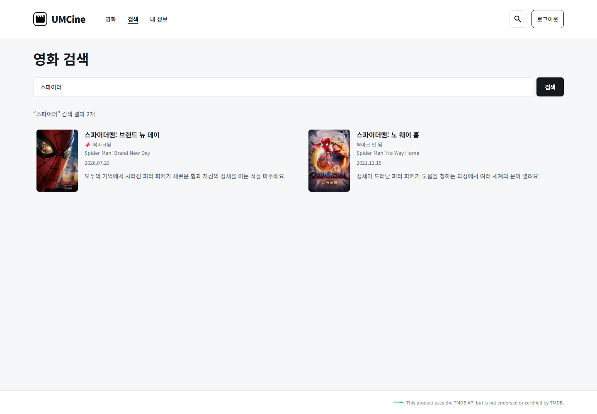
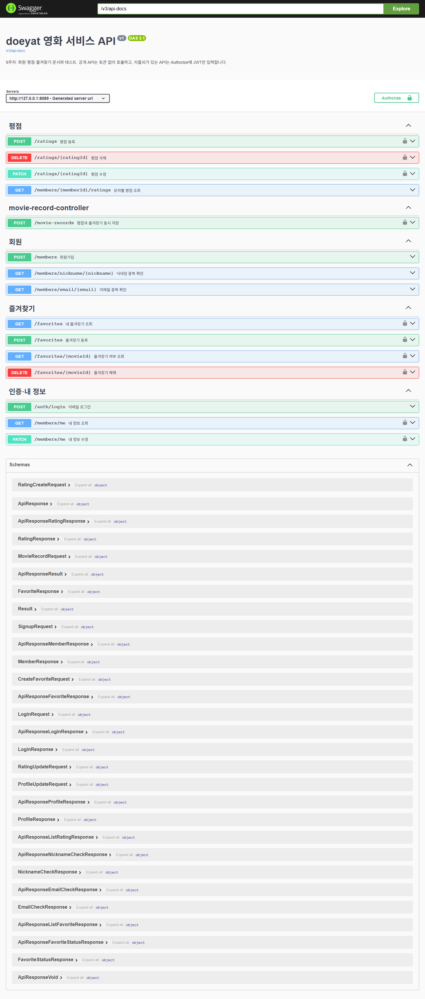
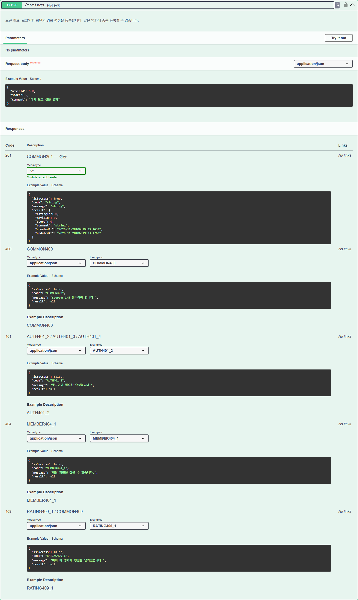
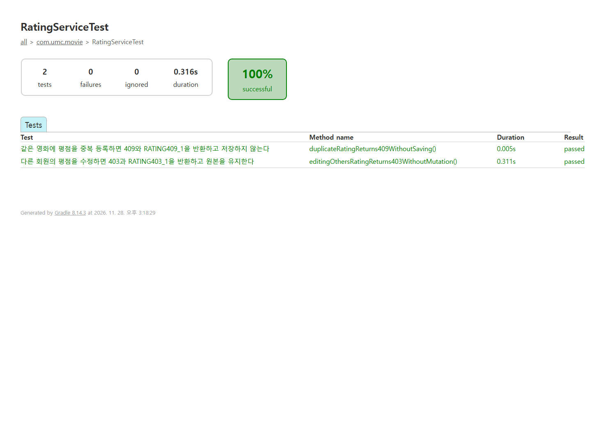
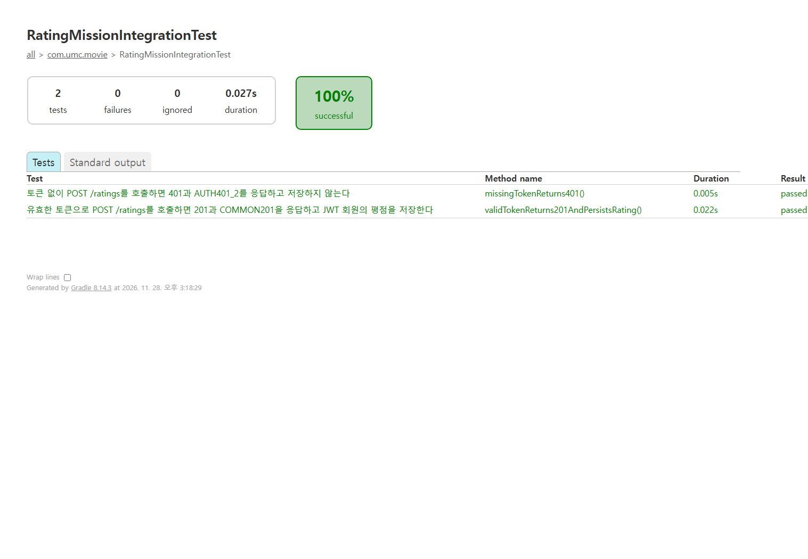
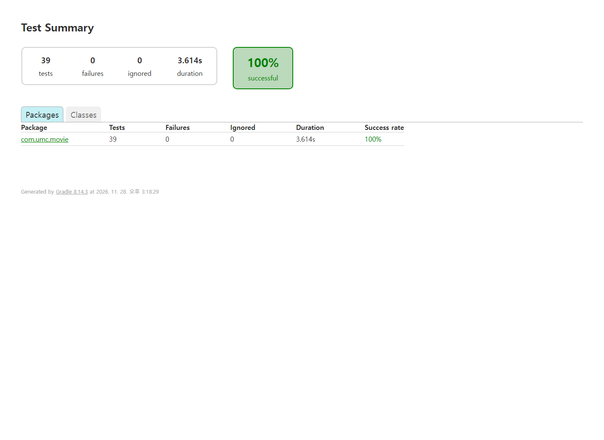

## 구현 내용

- Vite·TanStack Router를 Next.js App Router로 마이그레이션
- next/link·useRouter·useSearchParams·useParams로 라우팅 API 교체
- Server/Client Component 경계 및 저장소 복원 시점 분리
- 8주차의 토큰 영속 저장·서버 즐겨찾기·평점 CRUD·회원 수정 기능 유지
- 로그인 전용 Route Group과 공통 Layout 구성
- Swagger에 필수 API 9개의 설명·토큰 필요 여부·실패 상태와 code 문서화
- 평점 단위 테스트 2개·통합 테스트 2개 구현
- Next.js 빌드·타입 검사, 브라우저 테스트 3개, 백엔드 테스트 39개 통과

 

## 실행 화면

실제 Next.js 프로덕션 서버와 Spring Boot H2 로컬 서버를 연결해 헤드리스 Chromium으로 캡처했습니다. 영화 데이터는 로컬 샘플 모드입니다.

### 회원가입

### 평점 수정 후 새로고침

### 마이페이지 즐겨찾기

### Next.js 검색 경로

### Swagger API 문서

### 평점 등록 Swagger 문서

### 평점 단위 테스트 2개

### 평점 통합 테스트 2개

### 전체 테스트 39개 통과

 

## 느낀 점

라우터 API 교체뿐 아니라 환경 변수·프록시·Provider와 브라우저 저장소의 복원 시점까지 함께 고려해야 했습니다. Client Component도 서버에서 초기 HTML을 만들 수 있으므로 토큰 복원은 마운트 후 실행하고, 로그인 전용 화면은 복원이 끝난 뒤 접근 여부를 판단하도록 구성했습니다.

Swagger의 인증 표시는 실제 서버 인증과 일치해야 하며, 테스트도 예외 발생 여부뿐 아니라 HTTP 상태·업무 코드·DB 저장 여부를 함께 확인해야 한다는 점을 배웠습니다.
