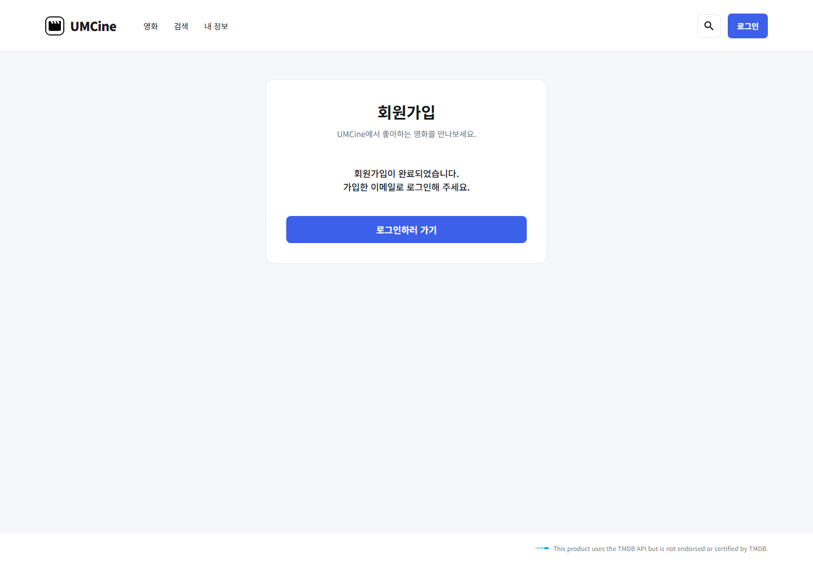
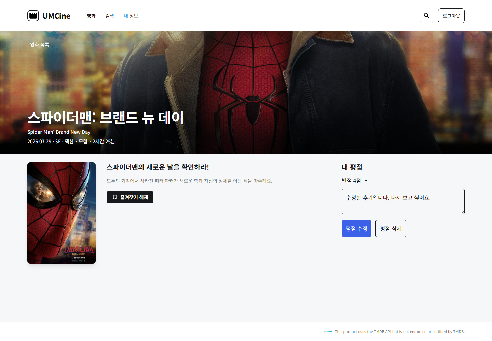
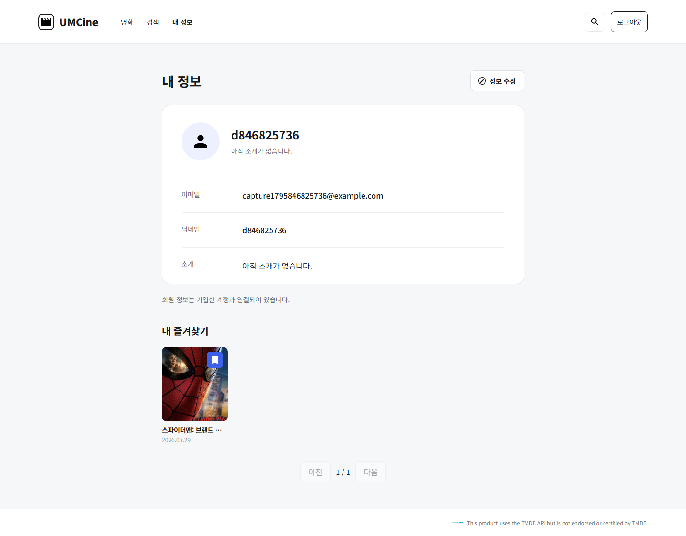
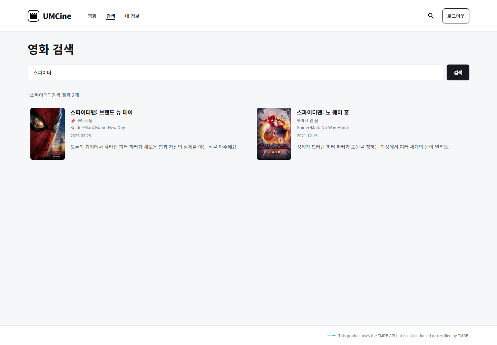
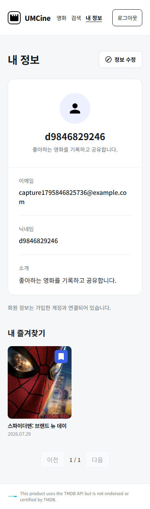

# 9주차 프론트 미션 기록

## 필수 미션: 기존 기능을 유지하며 Next.js로 마이그레이션

8주차 UMCine의 회원가입·로그인·회원 정보·서버 즐겨찾기·평점 CRUD를 유지했다. 기존 9주차 초안은 7주차 기반이어서 로컬 북마크와 화면 안의 평점만 있었으며, 이를 8주차의 서버 API 연결로 보완했다.

## 라우팅과 실행 설정

TanStack Router 전용 API를 제거하고 Next.js App Router로 옮겼다. page.tsx는 페이지 진입점과 metadata를 담당하고, features의 Client Component가 상호작용을 담당한다.

- Link to → next/link href
- Route.useNavigate → useRouter().push/replace
- Route.useSearch → useSearchParams와 URLSearchParams
- Route.useParams → useParams<{movieId:string}>
- 로그인 전용 Route Group → app/(authenticated)/layout.tsx
- Vite proxy → next.config.ts rewrites (기본 백엔드 8089)
- VITE_TMDB_READ_TOKEN → NEXT_PUBLIC_TMDB_READ_TOKEN
- Tailwind Vite 플러그인 → @tailwindcss/postcss

검색어·페이지 번호를 URL에 보존하며 잘못된 영화 ID에는 요청하지 않는다. useSearchParams 화면에는 Suspense 경계를 둔다.

## Server / Client 경계와 상태

Server Component: 공통 layout, 페이지 진입점, metadata, not-found.
Client Component: Provider, 폼·이벤트·navigation hook·Query·Zustand를 사용하는 기능 화면과 헤더.

QueryClient는 Provider의 useState 초기화 함수에서 만들고 인스턴스를 유지한다. 회원 정보와 즐겨찾기는 Query 캐시로 관리하며, 토큰만 Zustand persist에 저장한다. 로그인 후 invalidateQueries, 정보 수정 응답에는 setQueryData를 사용한다.

Client Component도 서버에서 초기 HTML을 생성할 수 있으므로 localStorage 복원을 렌더링 중 실행하지 않는다. auth-store에 skipHydration: true를 적용하고 Provider의 effect에서 rehydrate()를 호출한다. AuthBoundary는 복원이 끝나기 전에는 로딩을 표시하고, 완료 후 토큰이 없으면 로그인 화면으로 이동한다. 이 경계는 화면 제어이며 실제 권한 검증은 백엔드 JWT 인터셉터가 담당한다.

## 검증

Next.js 프로덕션 빌드·타입 검사 통과. Playwright 테스트 3개 통과:

1. 목록 URL·페이지 이동과 서버 즐겨찾기의 새로고침 복원
2. 검색어 인코딩·뒤로 가기·동적 상세 직접 접근
3. 비로그인 접근 제한·잘못된 ID·404

추가 캡처 흐름에서 실제 회원가입·로그인·즐겨찾기·평점 등록/수정/삭제·회원 수정·모바일·로그아웃 접근 제한을 확인했다. 평점 수정 후 새로고침해도 4점과 수정 후기가 유지되는 것을 검증했다. UI 오류 이벤트도 없어야 통과하도록 했다.

## 배운 점

라우터뿐 아니라 실행 설정과 환경 변수, Provider, 브라우저 저장소의 복원 시점도 함께 옮겨야 했다. 특히 첫 렌더링과 저장소 복원을 분리해야 서버와 브라우저의 화면 상태를 맞추고, 로그인된 사용자가 복원 전에 로그인 화면으로 이동하는 문제를 막을 수 있었다.

8주차 기능 유지 여부는 빌드만으로 판단하기 어려웠다. 실제 API와 연결해 평점·즐겨찾기의 저장 및 새로고침 복원을 확인했다.
