# 9주차 백엔드 미션 기록 — API 문서화와 평점 테스트

## 1. 미션 목표

Swagger 문서에서 각 API의 역할과 토큰 필요 여부를 확인할 수 있게 만들고, 평점 API의 성공·실패 규칙을 테스트 코드로 고정했다. 특히 실패 응답은 HTTP 상태 코드만 확인하지 않고 `RATING409_1`, `RATING403_1` 같은 업무 코드까지 함께 확인했다.

필수 제출물인 **Swagger 화면 캡처, 평점 테스트 코드, 전체 테스트 통과 화면**을 아래에 첨부했다. 캡처는 실행 중인 서버와 실제 Gradle 보고서를 헤드리스 Chromium으로 열어 직접 생성했다.

## 2. 기존 코드 확인과 작업 범위

8주차의 JWT·즐겨찾기·평점·영화 기록 기능을 9주차 독립 백엔드로 이어간다. 기존 9주차 초안의 Swagger와 필수 평점 테스트에 더해 8주차 영화 기록 트랜잭션 API도 유지하도록 보완했다. 선택 미션의 트랜잭션 제거 전후 비교 실험은 이번 제출 범위에 포함하지 않았다.

## 3. Swagger 설정

Spring Boot 3.5 프로젝트에 워크북의 `springdoc-openapi-starter-webmvc-ui:2.8.9`를 추가했다. `SwaggerConfig`에 문서 제목·설명·버전과 HTTP Bearer 인증 방식을 등록했다.

```java
new OpenAPI()
    .info(new Info().title("doeyat 영화 서비스 API").version("v1"))
    .components(new Components().addSecuritySchemes("bearerAuth",
        new SecurityScheme().type(SecurityScheme.Type.HTTP)
            .scheme("bearer").bearerFormat("JWT")));
```

인증 방식을 등록하는 것과 모든 API에 인증을 요구하는 것은 다르다. 전역 인증 요구사항은 추가하지 않고, 보호할 메서드에만 `@SecurityRequirement(name = "bearerAuth")`를 붙였다. 회원가입·로그인·유저별 평점 조회는 공개 API로 남겼다.

기존 인터셉터는 전체 경로를 차단하는 구조가 아니라 보호할 경로만 지정하는 구조였다. 따라서 Swagger 경로는 원래 공개 상태이며, 별도의 전체 경로 차단이나 불필요한 예외 목록을 추가하지 않았다. 즐겨찾기와 영화 기록 경로를 기존 인증 대상에 추가했다. 문서의 자물쇠 표시는 실제 인증 로직을 대신하지 않는다.

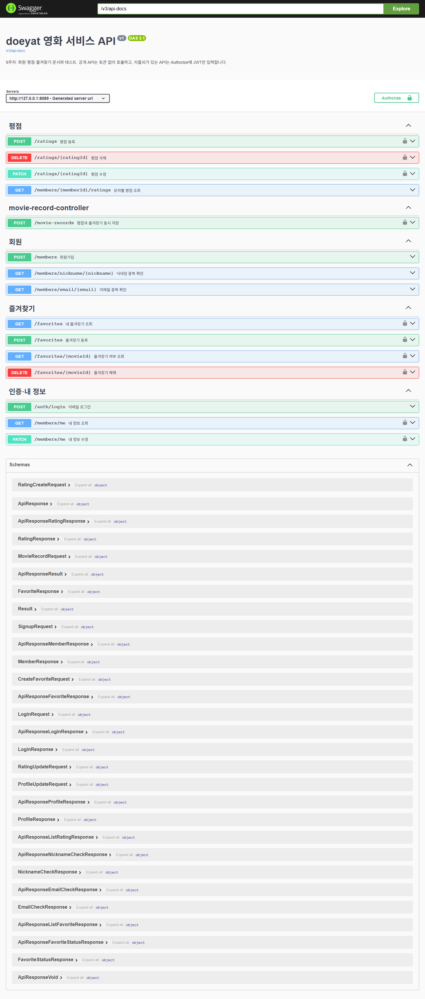

## 4. 필수 API 9개 문서화

각 메서드에 `@Operation`으로 한 줄 설명과 토큰 필요 여부를 적었다. 오류 응답에는 `@ApiResponses`로 HTTP 상태와 JSON 예시의 `code`를 함께 기록했다.

| API | 토큰 | 주요 응답 |
| --- | --- | --- |
| `POST /ratings` | 필요 | 201 `COMMON201`, 400 `COMMON400`, 401 `AUTH401_2/3/4`, 404 `MEMBER404_1`, 409 `RATING409_1` |
| `PATCH /ratings/{ratingId}` | 필요 | 200 `COMMON200`, 400 `COMMON400`, 401 `AUTH401_2/3/4`, 403 `RATING403_1`, 404 `RATING404_1` |
| `DELETE /ratings/{ratingId}` | 필요 | 200 `COMMON200`, 401 `AUTH401_2/3/4`, 403 `RATING403_1`, 404 `RATING404_1` |
| `GET /members/{memberId}/ratings` | 불필요 | 200 `COMMON200`, 404 `COMMON404` |
| `GET /members/me` | 필요 | 200 `COMMON200`, 401 `AUTH401_2/3/4`, 404 `MEMBER404_1` |
| `PATCH /members/me` | 필요 | 200 `COMMON200`, 400 `COMMON400`, 401 `AUTH401_2/3/4`, 404 `MEMBER404_1`, 409 `MEMBER4091` 또는 `MEMBER409_1` |
| `GET /favorites` | 필요 | 200 `COMMON200`, 401 `AUTH401_2/3/4` |
| `GET /favorites/{movieId}` | 필요 | 200 `COMMON200`, 401 `AUTH401_2/3/4` |
| `DELETE /favorites/{movieId}` | 필요 | 200 `COMMON200`, 401 `AUTH401_2/3/4`, 404 `FAVORITE404_1` |

위 표는 주요 응답이다. 기존 DB 제약 충돌은 409 `COMMON409`, 잘못된 숫자 경로 등은 공통 예외 처리의 400 `COMMON400`으로 처리된다. `AUTH401_2`는 토큰 누락, `AUTH401_3`은 유효하지 않은 토큰, `AUTH401_4`는 만료된 토큰이다.

내 정보 수정의 이메일 중복 코드는 기존 구현의 `MEMBER4091`, 닉네임 중복은 `MEMBER409_1`이다. 코드 이름을 문서에서 임의로 통일하지 않고 실제 구현에 맞췄다. 평점 삭제도 기존 동작에 맞춰 204가 아닌 200으로 문서화했다.

JWT 인터셉터가 주입하는 `@RequestAttribute("memberId")`는 `@Parameter(hidden = true)`로 숨겼다. 사용자가 다른 회원 ID를 입력하는 API로 오해하지 않도록 하기 위해서다. 등록·수정 DTO에는 영화 ID·점수·감상 등의 예시를 추가했다.

### 평점 등록·수정·삭제·회원별 조회

등록 문서에는 정상 응답 외에 400·401·404·409와 오류 코드 예시가 표시된다.

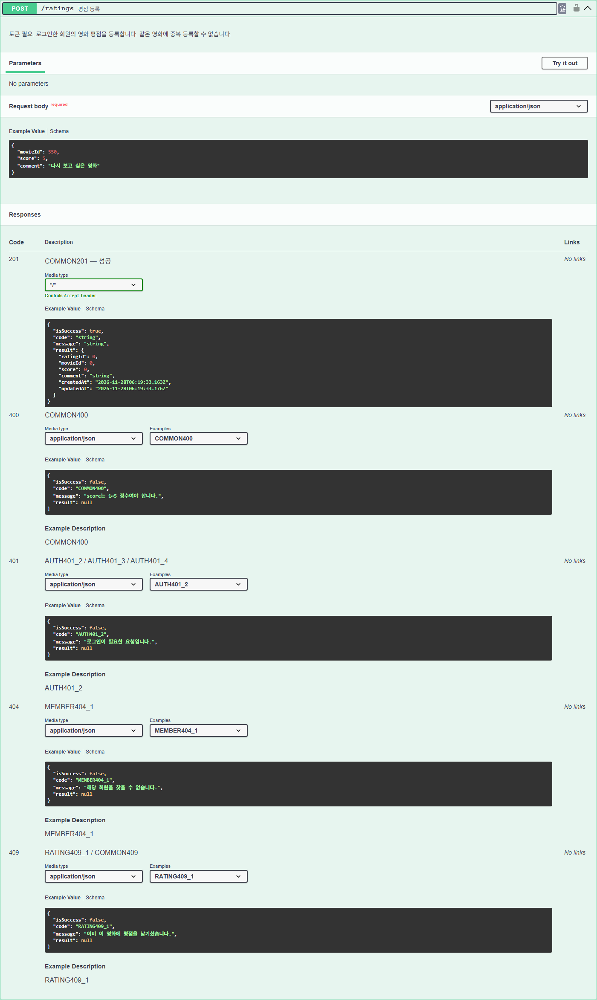

수정과 삭제에는 다른 회원의 평점에 접근했을 때의 403 `RATING403_1`을 기록했다.

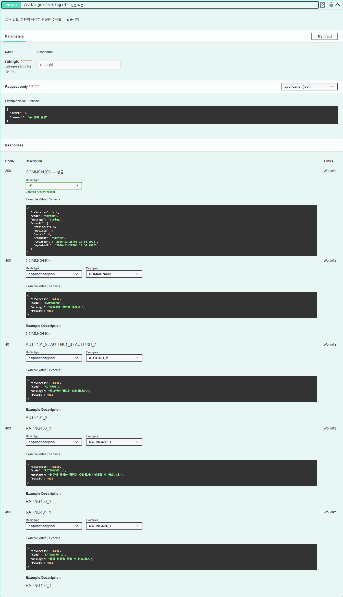

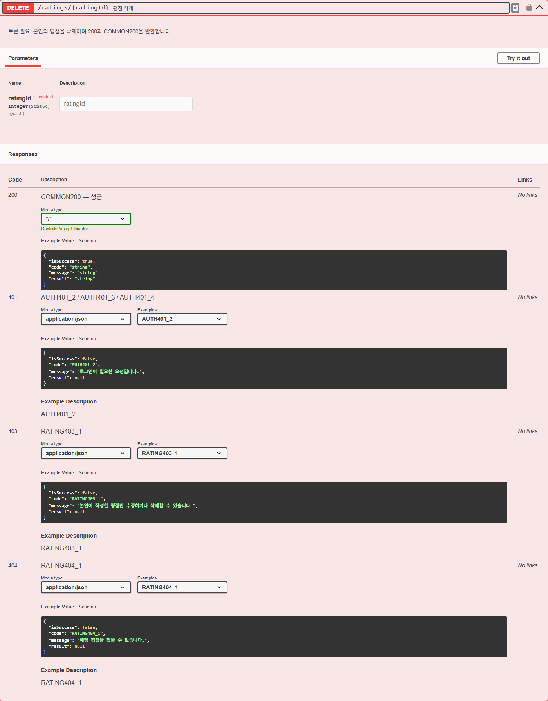

유저별 평점 조회는 공개 API이며 자물쇠 없이 호출할 수 있다.

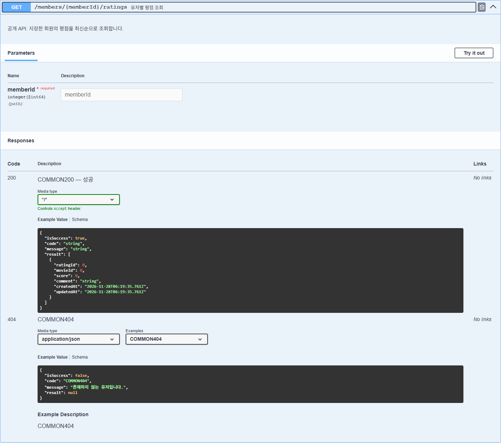

### 내 정보 조회·수정

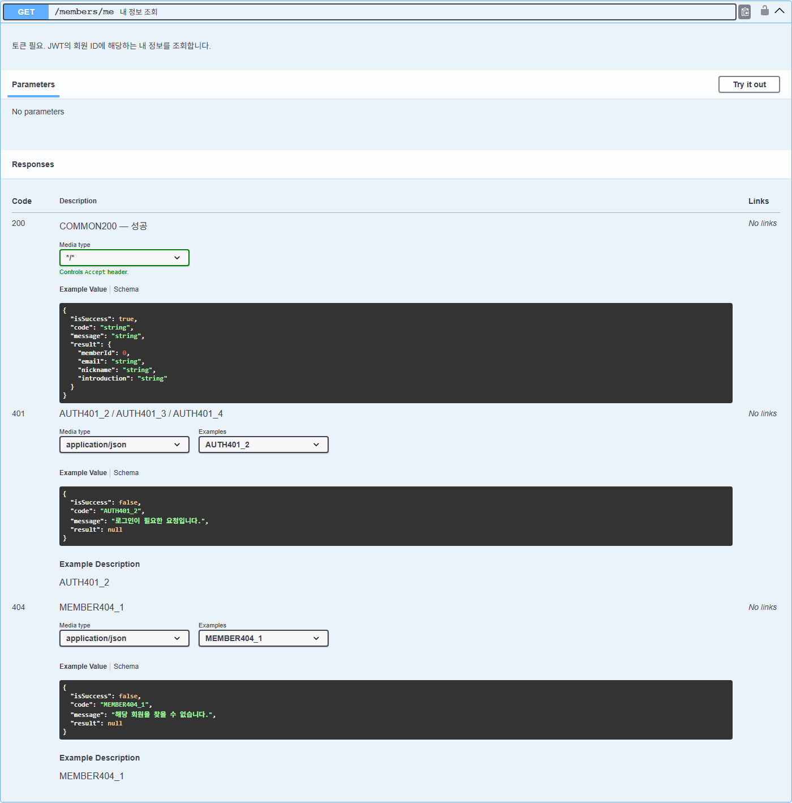

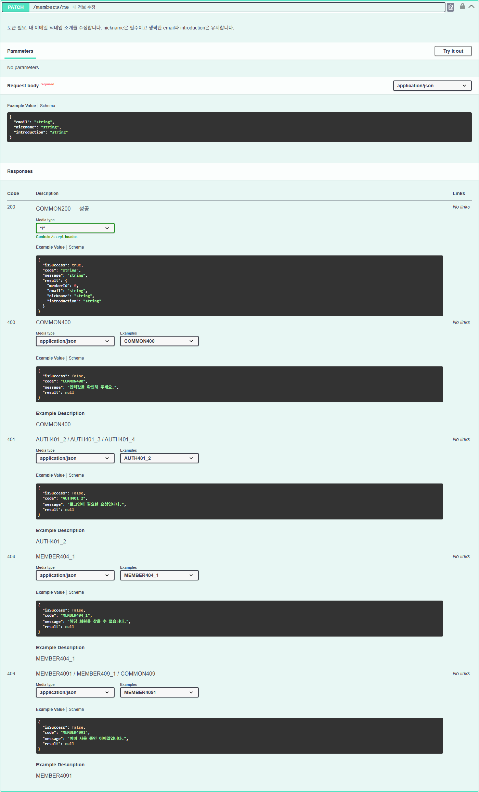

### 내 즐겨찾기 목록·여부·해제

즐겨찾기가 없는 목록은 빈 배열로, 즐겨찾기하지 않은 영화의 여부는 200과 `isFavorite: false`로 응답한다. 해당 상태를 오류로 다루지 않았다.

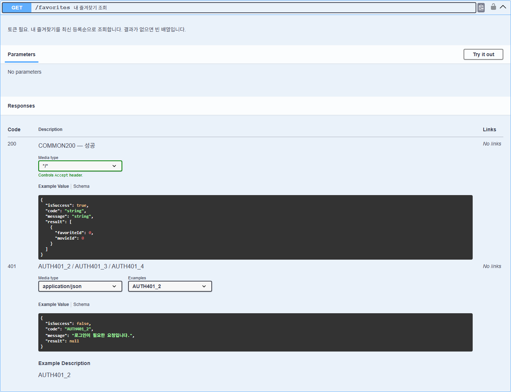

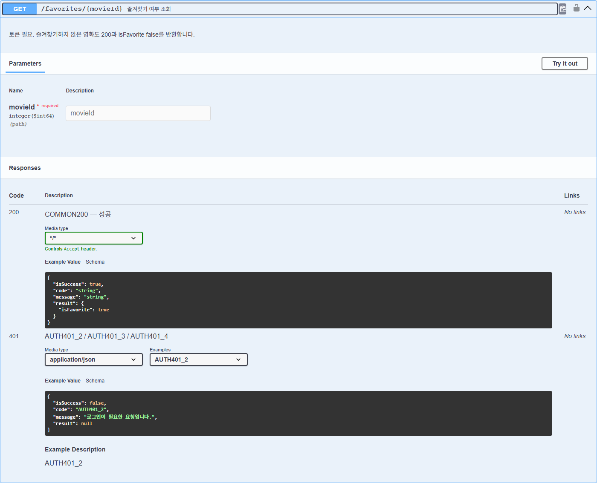

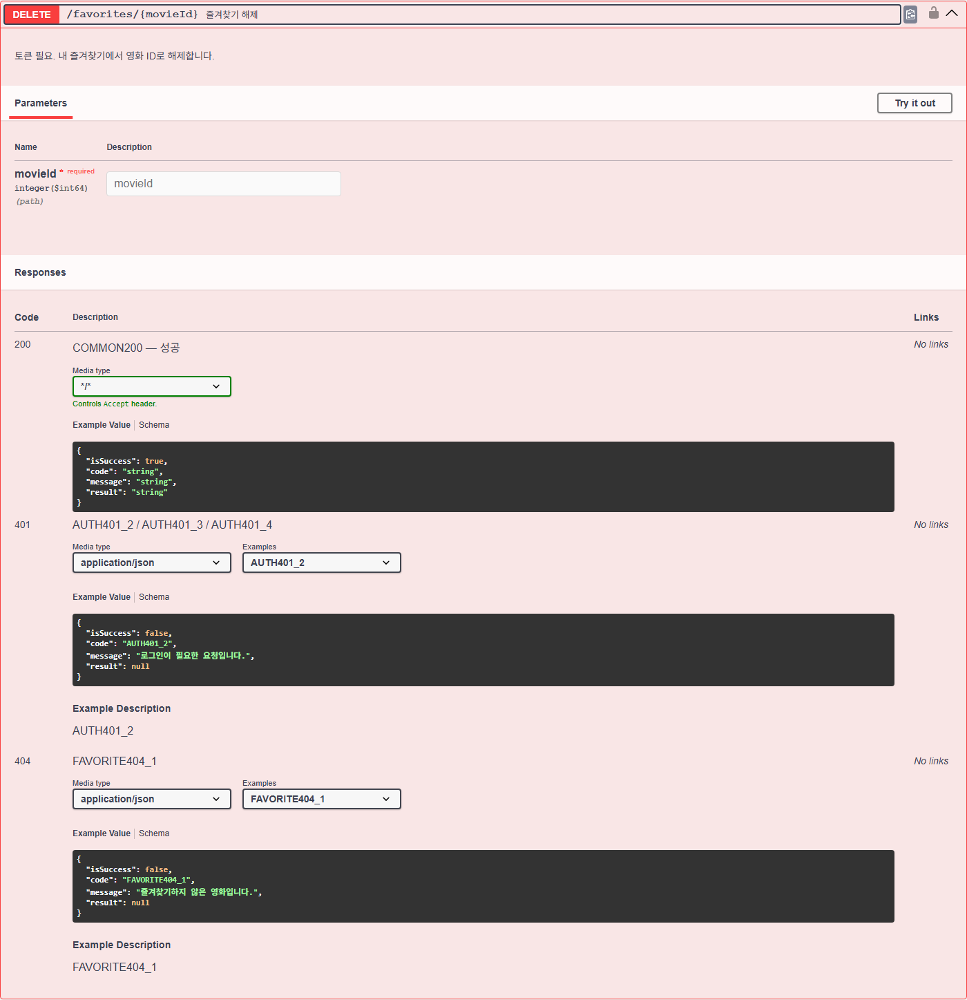

## 5. 평점 단위 테스트 2개

테스트 코드: [RatingServiceTest.java](../backend/src/test/java/com/umc/movie/RatingServiceTest.java)

`@ExtendWith(MockitoExtension.class)`와 가짜 Repository를 사용해 Spring 서버나 DB 없이 서비스의 판단을 검증했다. 테스트는 given → when → then으로 나누고, `@DisplayName`에 검증 조건과 기대 결과를 적었다.

### 같은 영화에 평점 중복 등록

- given: 회원이 존재하며, 같은 영화의 평점이 이미 있다고 Mock 응답을 설정한다.
- when: `RatingService.create()`를 호출한다.
- then: `ApiException`의 상태가 409, 코드가 `RATING409_1`인지 확인한다. `saveAndFlush()`가 호출되지 않는지도 검증한다.

```java
assertThatThrownBy(() -> service.create(1L, request))
    .isInstanceOfSatisfying(ApiException.class, error -> {
        assertThat(error.getStatus()).isEqualTo(HttpStatus.CONFLICT);
        assertThat(error.getCode()).isEqualTo("RATING409_1");
    });
verify(ratings, never()).saveAndFlush(any(Rating.class));
```

### 다른 회원의 평점 수정

- given: 평점 소유자는 1번 회원, 수정 요청자는 2번 회원이다.
- when: `RatingService.update()`를 호출한다.
- then: 403과 `RATING403_1`인지 확인한다. 원본 점수·감상이 바뀌지 않고 `flush()`도 호출되지 않아야 한다.

단순히 예외 발생 여부만 확인하는 것보다 구체적인 업무 규칙과 변경 방지를 함께 확인할 수 있었다.

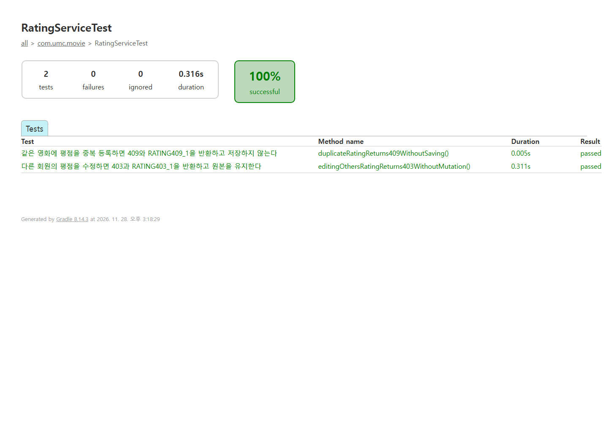

## 6. 평점 통합 테스트 2개

테스트 코드: [RatingMissionIntegrationTest.java](../backend/src/test/java/com/umc/movie/RatingMissionIntegrationTest.java)

`@SpringBootTest`, `@AutoConfigureMockMvc`, `@ActiveProfiles("test")`를 사용했다. 테스트 DB는 MySQL 대신 H2 메모리 DB이며, 테스트에는 `@Transactional`을 적용해 남긴 데이터를 되돌린다.

MockMvc는 실제 네트워크 포트를 열지 않고 Spring MVC의 인증 인터셉터·컨트롤러·서비스·Repository·예외 처리 흐름을 거친다. JWT도 가짜 인증 우회가 아니라 프로젝트의 `JwtUtil`로 발급한 토큰을 전달했다.

### 토큰 없이 평점 등록

`POST /ratings`에 본문만 보내고 HTTP 401, `isSuccess: false`, `code: AUTH401_2`를 확인했다. 요청 전후의 평점 개수가 같은지도 검사했다.

### 유효한 토큰으로 평점 등록

테스트 회원을 DB에 저장하고 그 회원의 JWT를 발급했다. Authorization 헤더와 평점 본문을 보내 HTTP 201, `COMMON201`, 응답의 `movieId: 550`·`score: 5`를 확인했다. 마지막에는 JWT의 회원 ID와 영화 ID로 저장된 평점이 실제 DB에 존재하는지 확인했다.

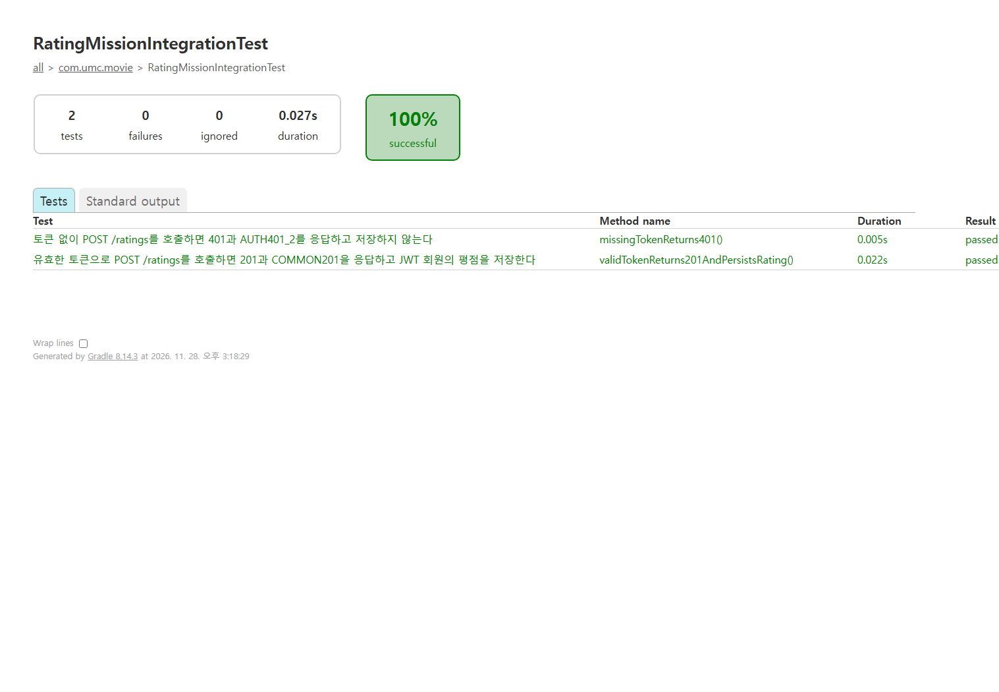

## 7. Swagger에서 실제 HTTP 요청 확인

실행 중인 서버에서 회원가입과 로그인을 진행하고, Swagger의 Authorize에 발급된 JWT를 입력했다. 이후 Try it out / Execute로 요청을 보냈다. 아래는 Mock 응답이 아니라 Swagger UI에 표시된 실제 서버 응답이다. 토큰이 들어간 curl 영역은 촬영하지 않고 응답 표만 캡처했다.

### 토큰 없는 평점 등록: 401 / AUTH401_2

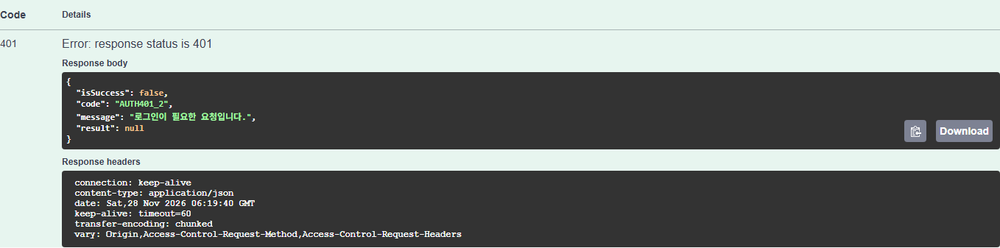

### 토큰을 넣은 평점 등록: 201 / COMMON201

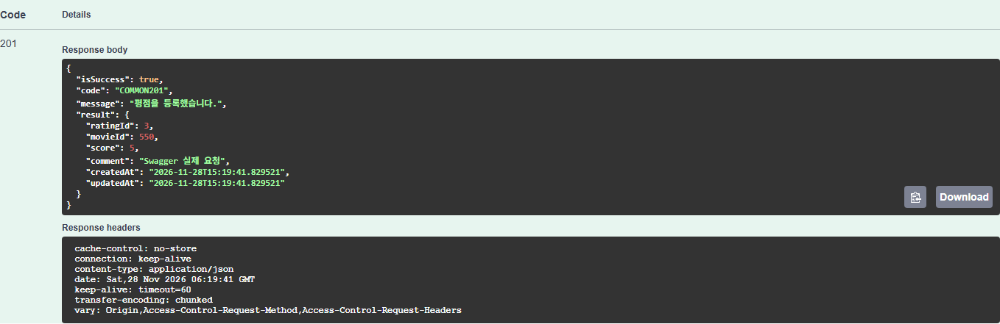

### 동일 영화에 평점 재등록: 409 / RATING409_1

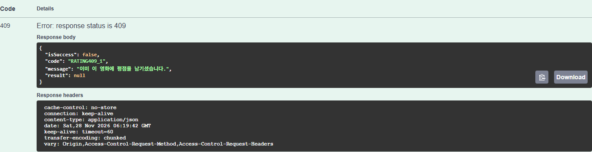

보완한 즐겨찾기 API도 Authorize 후 201 등록 성공과 동일 영화 재등록의 409 `FAVORITE409_1`을 확인했다.

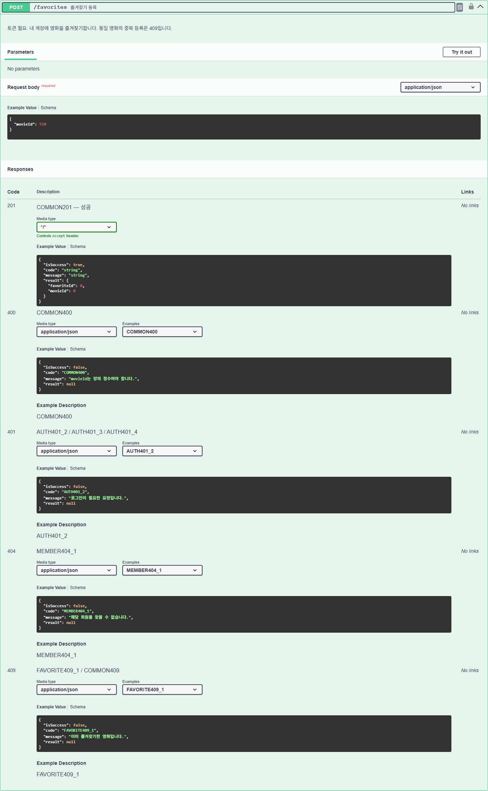

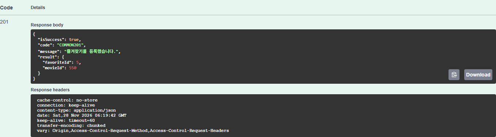

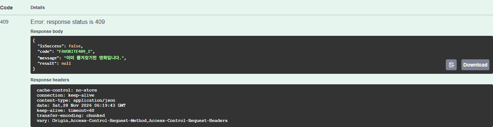

## 8. 전체 테스트 결과

```powershell
cd doeyat/week09/backend
.\gradlew.bat test bootJar
```

**전체 테스트 39개 통과 / 실패 0개 / 오류 0개 / 생략 0개.** 실행 가능한 JAR 빌드도 통과했다. 기존 회원·평점·CORS 테스트를 함께 실행해 회귀 여부를 확인했다.

추가한 Swagger 테스트는 공개 문서 경로와 필수 API 9개의 설명·인증 표시, 평점 409·403 오류 코드가 OpenAPI에 포함됐는지를 검증한다. 즐겨찾기 테스트는 인증·등록·중복·목록·여부·해제와 다른 회원 데이터 분리를 검증한다.

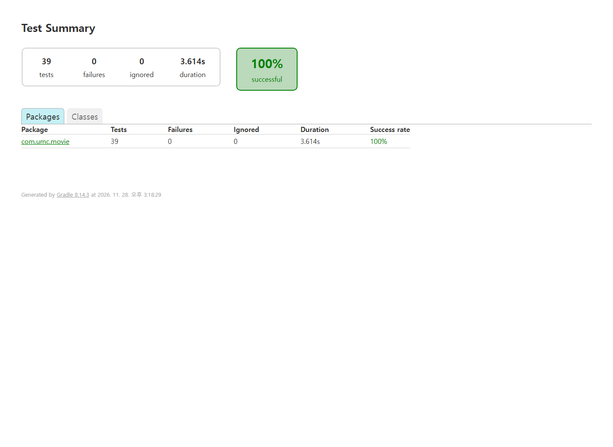

- [실제 Gradle HTML 보고서](backend-test-report/index.html)
- [캡처 당시 OpenAPI JSON](backend-screenshots/openapi.json)
- [헤드리스 캡처 결과 목록](backend-screenshots/capture-result.json)
- [헤드리스 캡처 스크립트](../web/scripts/capture-backend.mjs)

## 9. 진행 중 확인한 문제와 해결

### 기존 기능 유지

7주차 기반 초안에 빠져 있던 8주차 영화 기록 API를 유지하도록 추가했다. 프론트도 9주차 백엔드 8089에 연결해 서버 즐겨찾기와 평점 기능을 실제 검증했다.

### 오류 코드와 상태를 혼동할 수 있는 문제

같은 HTTP 상태라도 원인이 다를 수 있었다. 예를 들어 401에는 토큰 누락·변조·만료가 있고, 409에도 업무상 중복과 DB 제약 충돌이 있다. Swagger에는 상태와 `code`를 함께 적고, 테스트도 해당 코드까지 확인하도록 작성했다.

### Swagger 인증 버튼 자동화 문제

헤드리스 캡처 중 화면 글자는 `Authorize`인데 접근성 이름이 `Apply credentials`인 버튼을 찾지 못해 타임아웃이 발생했다. 실제 DOM의 `aria-label`을 확인하고 접근성 이름으로 선택자를 수정했다. 이후 인증된 요청과 응답을 캡처할 수 있었다.

## 10. 배운 점

Swagger는 경로와 DTO 구조를 자동으로 보여주지만, 인증이 필요한지와 실패 원인이 무엇인지는 직접 정확히 기록해야 했다. 특히 자물쇠 표시만 추가한다고 인증이 적용되는 것은 아니므로 실제 인터셉터 설정과 함께 확인해야 했다.

단위 테스트는 서비스의 판단을 빠르게 확인하고, 통합 테스트는 인증부터 저장까지 연결된 흐름을 확인하는 역할을 했다. 예외가 발생했다는 사실에서 멈추지 않고 저장되지 않았는지, 원본이 유지되는지, 정상 요청이 실제로 저장됐는지 확인하는 것이 중요했다.

## 참고 자료

- [springdoc-openapi 공식 문서](https://springdoc.org/)
- [Spring Framework MockMvc 공식 문서](https://docs.spring.io/spring-framework/reference/testing/mockmvc.html)

작성자: **doeyat (도얏)**
