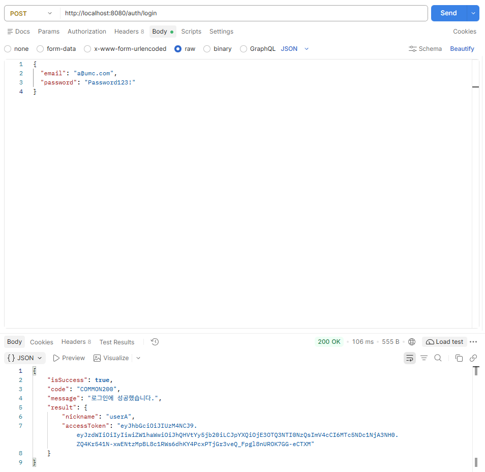
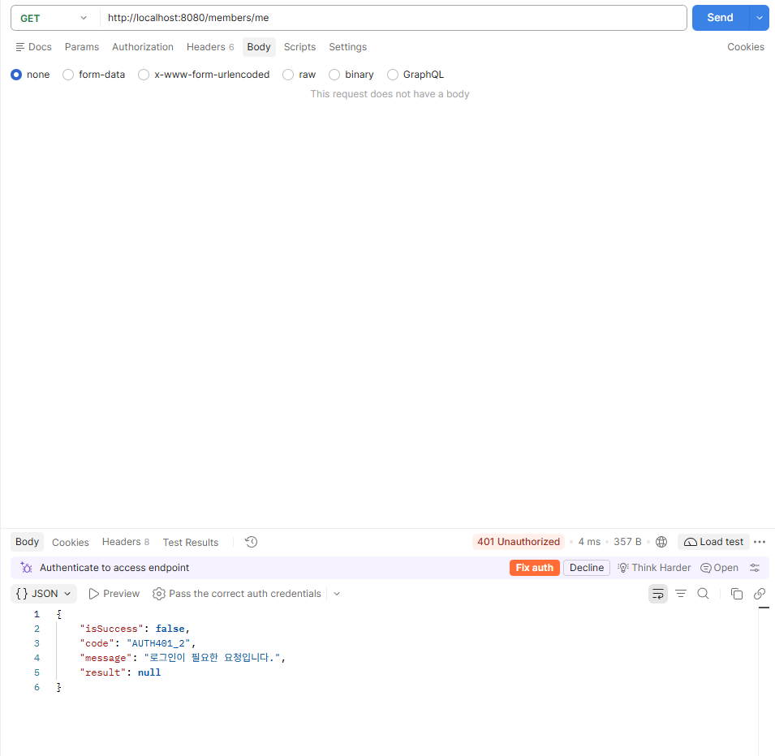
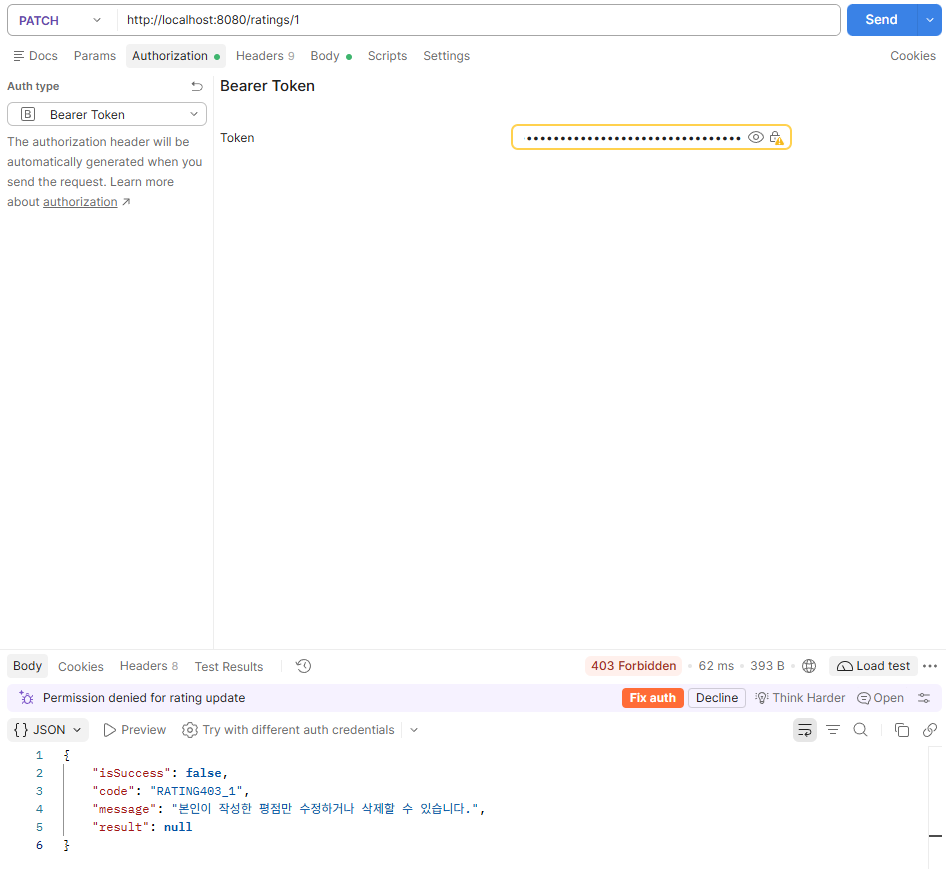
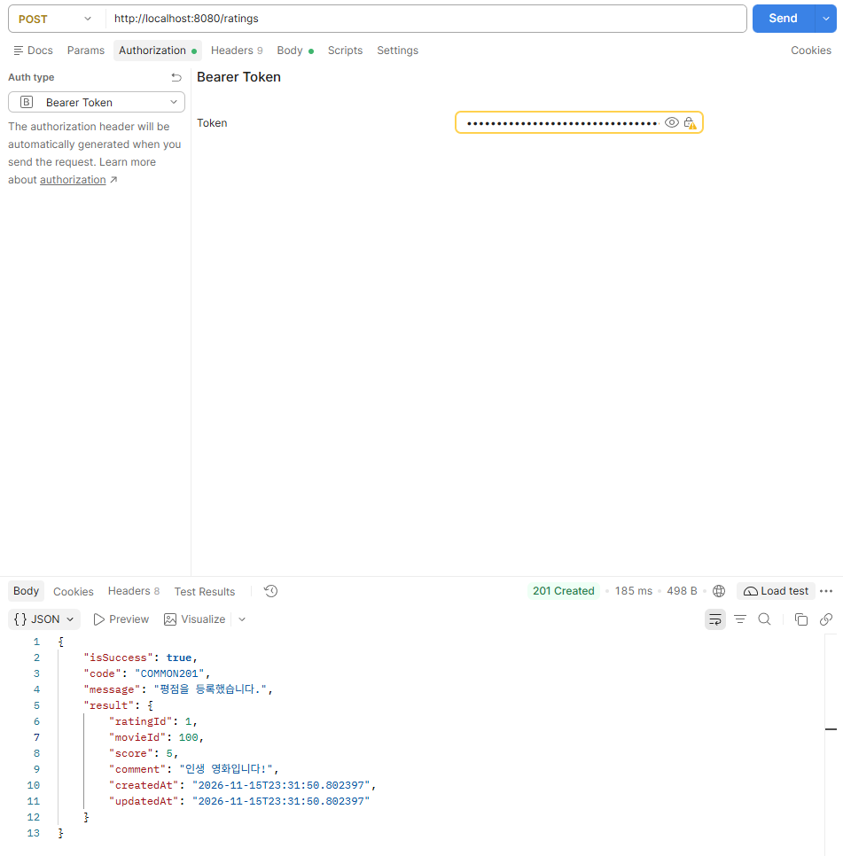

# 7주차 워크북 및 실습 프로젝트 (Week 7)

## 📌 구성 안내

- 📄 [`7주차 - 인증 개념 이해와 회원가입 구현하기.md`](./7주차%20-%20인증%20개념%20이해와%20회원가입%20구현하기%20162d62e145e38383b61d814ab1b8f790.md) (프론트엔드 워크북)
- 📄 [`7주차 - 로그인한 사용자를 구분하기.md`](./7주차%20-%20로그인한%20사용자를%20구분하기%20318d62e145e382629a30810d0cb24031.md) (백엔드 워크북)
- 📁 [`umcine/`](./umcine) (React 19 + TanStack Router + Tailwind CSS 영화 애플리케이션)
- 📁 [`spring/`](./spring) (Spring Boot 3.5 + JPA + JJWT 0.12 + BCrypt 회원 & 영화 평점 백엔드)

---

## 🚀 백엔드 (`spring`) 실행 및 테스트 방법

### 1. 서버 구동
```bash
cd hoon/week7/spring
./gradlew.bat bootRun
```
*(H2 인메모리 프로파일 실행 시: `./gradlew.bat bootRun --args='--spring.profiles.active=local'`)*

### 2. 시나리오 자동 검증 스크립트 실행
서버가 뜬 상태에서 새 터미널을 열고 아래 스크립트를 실행하면 9단계 전체 시나리오를 한 번에 검증할 수 있습니다:
```powershell
cd hoon/week7/spring
.\test-api.ps1
```

### 3. 브라우저 테스트 콘솔
서버 구동 후 브라우저에서 [http://localhost:8080/static/api-test.html](http://localhost:8080/static/api-test.html) 로 접속하시면 UI 상에서 로그인, 토큰 발급, 401/403 권한 제어를 시각적으로 클릭하며 테스트하고 결과를 확인할 수 있습니다.

---

## 🚀 프론트엔드 (`umcine`) 실행 방법

```bash
cd hoon/week7/umcine
npm run dev # 또는 pnpm dev
```
- 회원가입 페이지: `http://localhost:5173/signup`
- 로그인 페이지: `http://localhost:5173/login`
- 내 정보 조회: `http://localhost:5173/my`
- 내 정보 수정: `http://localhost:5173/my/edit`

---

## ✨ 핵심 구현 내용

### 1. 백엔드 (Spring Boot)
- **표준 예외 처리 체계 구축 (`ApiException`, `GlobalExceptionHandler`)**:
  - 상태 코드와 도메인별 세분화된 에러 코드(`AUTH401_1` ~ `AUTH401_4`, `RATING403_1`, `RATING409_1` 등)를 일관되게 규격화
- **로그인 & JWT 토큰 발급 (`POST /auth/login`)**:
  - `JwtUtil`: HMAC-SHA 비밀키 기반 서명 생성 및 검증, 만료 시간 관리
  - 보안 강화: 이메일 미존재와 비밀번호 불일치 시 `AUTH401_1` 단일 코드로 통일하여 회원 가입 여부 추측 방지
- **관문 기반 전역 인증 (`AuthInterceptor`, `WebConfig`)**:
  - `Authorization: Bearer {token}` 검증 후 `memberId`를 `request.setAttribute`에 저장
  - 화이트리스트 방식: 공개 경로(로그인, 회원가입, 중복체크, 유저별 평점 목록)를 제외한 모든 엔드포인트 자동 보호
- **내 정보 조회 및 수정 API (`GET/PATCH /members/me`)**:
  - 본인 토큰 기반 사용자 정보 조회
  - 닉네임 수정 시 본인을 제외한 타 회원과의 중복 여부 검사(`existsByNicknameAndMemberIdNot`)
- **평점 CRUD 토큰 기반 리팩토링 (`/ratings`)**:
  - `POST /ratings`: 바디에서 `memberId` 제거, 토큰 주인을 작성자로 등록 (`201 Created`)
  - `PATCH /ratings/{ratingId}`: 작성자 본인 검증 후 수정 (`200 OK`), 타인 시도 시 인가 거부 (`403 Forbidden`, `RATING403_1`)
  - `DELETE /ratings/{ratingId}`: `204` 대신 공통 포맷(`200 OK`, `ApiResponse.ok(..., null)`)으로 응답 규격 일원화
- **선택 미션 완수**:
  - `@LoginMember` 커스텀 어노테이션 및 `HandlerMethodArgumentResolver` 구현으로 컨트롤러에서 문자열 `"memberId"` 반복 추출 코드 완전 제거

### 2. 프론트엔드 (React)
- **회원가입 (`/signup`)**: 이메일/닉네임/비밀번호 정규식 유효성 검사, 중복 확인 API 연동 및 상태 분기, 로딩 스피너 제어
- **[필수 미션] 로그인 & 내 정보 화면 퍼블리싱**: `/login`, `/my`, `/my/edit` 화면 완성 및 입력 연동
- **[선택 미션] 폴더 구조 설계**: `/routes/my/` 및 `/pages/my/` 모듈화 그룹화


---

## 📸 미션 검증 결과 (Postman 테스트 캡처)

| 1. 로그인 성공 (토큰 발급) | 2. 토큰 미전달 시 401 차단 |
| :---: | :---: |
|  |  |

| 3. 타인 평점 수정 시 403 차단 | 4. 본인 토큰 평점 등록 (201 Created) |
| :---: | :---: |
|  |  |
